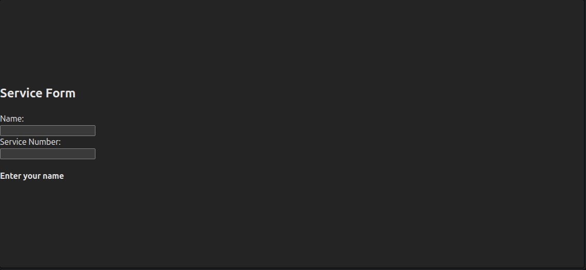

# Form Storage (Custom Hooks)

A React application for a repair service form that persists user input across browser refreshes using a reusable `useLocalStorage` custom hook.

## Screenshot



## Features

- **Custom `useLocalStorage` Hook:** Encapsulates `useState` and `useEffect` logic to read initial state from `window.localStorage` and synchronize updates automatically whenever state or keys change.
- **Persistent Form Inputs:** Connects both the `"name"` and `"serviceNumber"` inputs to `localStorage` so users do not lose entered data if the page reloads.

## Technologies Used

- React (`useState`, `useEffect`, Custom Hooks)
- Web Storage API (`localStorage`)
- Vite

## Getting Started

1. Clone the repository:
   ```bash
   git clone https://github.com<your-custom-hooks-repo-name>.git
   ```
2. Install dependencies:
   ```bash
   npm install
   ```
3. Start the development server:
   ```bash
   npm run dev
   ```
4. Run the test suite:
   ```bash
   npm run test
   ```